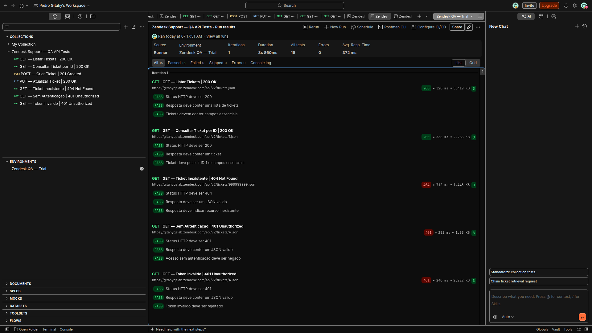
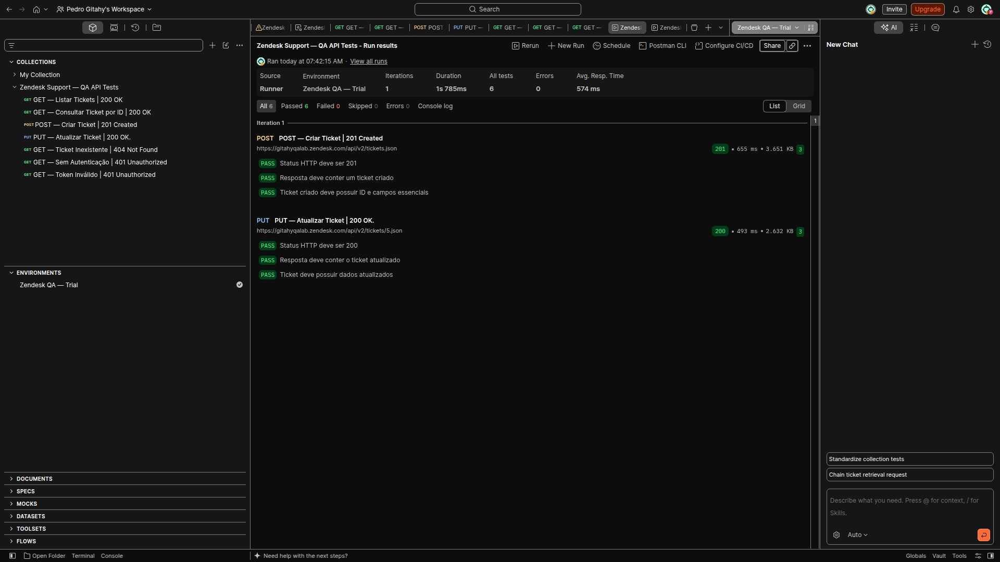

# Zendesk Support — API Testing with Postman


Automated REST API testing project developed using **Postman and JavaScript**, focused on validating ticket management operations, authentication behavior, HTTP responses, and dynamic request chaining within the Zendesk Support API.

This project demonstrates practical Quality Assurance techniques through positive and negative test scenarios, automated assertions, and reproducible collection-based workflows.

---

## Project Overview

The objective of this project is to validate essential operations of the Zendesk Support Tickets API, ensuring that expected responses, data structures, authentication requirements, and ticket modifications behave correctly.

The project covers:

- Retrieval of ticket lists and individual tickets.
- Creation and updating of support tickets.
- Validation of HTTP response status codes.
- Verification of JSON response structures and required fields.
- Negative testing for nonexistent resources.
- Authentication and invalid-token validation.
- Dynamic request chaining using environment variables.
- Automated test execution through Postman Collection Runner.

Testing was performed against a dedicated Zendesk Support trial environment.

---

## Technologies and Tools

| Technology | Purpose |
|---|---|
| Postman | API request management and test execution |
| JavaScript | Automated assertions and response validation |
| Zendesk Support API | REST API under test |
| OAuth 2.0 | API authentication |
| Authorization Code with PKCE | OAuth authorization flow |
| JSON | Request and response data format |
| Postman Collection Runner | Automated execution and reporting |
| GitHub | Source control and portfolio documentation |

---

## Testing Approach

The project follows a structured API testing approach combining functional validation, positive and negative scenarios, and automated response assertions.

### Positive Testing

Valid requests are executed to verify expected API behavior, including:

- Successful retrieval of ticket data.
- Successful creation of support tickets.
- Successful modification of existing tickets.
- Presence of required JSON properties.
- Validation of expected ticket attributes.

### Negative Testing

Invalid requests are executed to verify appropriate error handling and access restrictions.

Scenarios include:

- Retrieval of a nonexistent ticket.
- Access attempts without authentication.
- Access attempts using an invalid bearer token.

### Automated Assertions

Each request contains three JavaScript assertions implemented using the Postman `pm.test()` API.

Assertions validate HTTP status codes, JSON response content, and scenario-specific expectations.

### Dynamic Request Chaining

The POST request captures the ID of a newly created ticket and stores it in a Postman environment variable.

The subsequent PUT request reuses this value, allowing the workflow to operate without a hardcoded ticket identifier.

---

## Test Scenarios and Coverage

The collection contains **7 API requests and 21 automated test assertions**.

| ID | Method | Scenario | Expected Status |
|---|---|---|---|
| TC-01 | GET | List support tickets | 200 OK |
| TC-02 | GET | Retrieve ticket by ID | 200 OK |
| TC-03 | POST | Create a support ticket | 201 Created |
| TC-04 | PUT | Update an existing ticket | 200 OK |
| TC-05 | GET | Retrieve a nonexistent ticket | 404 Not Found |
| TC-06 | GET | Access ticket without authentication | 401 Unauthorized |
| TC-07 | GET | Access ticket with invalid token | 401 Unauthorized |

### Validated Behaviors

- Expected HTTP response codes.
- JSON object and array structures.
- Required ticket properties.
- Ticket ID validation.
- Ticket subject and priority validation.
- Successful ticket creation.
- Successful ticket modification.
- Error response validation.
- Authentication rejection behavior.

---

## API Endpoints

The tests use the following Zendesk Support API endpoints.

```http
GET {{base_url}}/api/v2/tickets.json

GET {{base_url}}/api/v2/tickets/1.json

POST {{base_url}}/api/v2/tickets.json

PUT {{base_url}}/api/v2/tickets/{{ticket_id}}.json

GET {{base_url}}/api/v2/tickets/9999999999.json
```

The authentication-negative scenarios use an existing ticket endpoint with different authorization configurations.

The `base_url` variable identifies the Zendesk instance, while `ticket_id` is dynamically assigned during the creation workflow.

---

## Dynamic Request Chaining — POST to PUT

A key feature of this project is the integration between ticket creation and ticket modification.

### Step 1 — Create Ticket

The POST request creates a ticket through:

```http
POST {{base_url}}/api/v2/tickets.json
```

The response is validated to confirm successful ticket creation and the expected attributes.

### Step 2 — Capture the Ticket ID

The created ticket ID is automatically stored using JavaScript:

```javascript
const ticketCriado = pm.response.json().ticket;

pm.environment.set("ticket_id", ticketCriado.id);
```

### Step 3 — Update the Created Ticket

The PUT request references the stored variable:

```http
PUT {{base_url}}/api/v2/tickets/{{ticket_id}}.json
```

The assertions verify:

- HTTP 200 OK.
- Presence of the updated ticket object.
- Consistency of the ticket ID.
- Expected subject and priority values.

This approach demonstrates dynamic data handling and dependency management between API requests.

---

## Test Execution Results

The collection was validated through two complementary executions using **Postman Collection Runner** on October 28, 2026.

| Execution | Requests | Passed | Failed | Errors | Duration |
|---|---:|---:|---:|---:|---:|
| GET and Negative Scenarios | 5 | 15 | 0 | 0 | 3.860 s |
| POST and PUT Workflow | 2 | 6 | 0 | 0 | 1.785 s |
| **Combined Results** | **7** | **21** | **0** | **0** | **5.645 s** |

**Result: 21/21 assertions passed across two separate executions.**

The combined results do not represent a single execution containing all seven requests.

---

## Test Execution Evidence

The following screenshots provide execution evidence captured directly from Postman Collection Runner.

### Execution 01 — GET and Negative Test Scenarios

**15 Passed | 0 Failed | 0 Errors**

Five requests were executed to validate ticket retrieval, nonexistent-resource handling, and authentication rejection behavior.



### Execution 02 — POST and PUT Workflow

**6 Passed | 0 Failed | 0 Errors**

Two requests were executed sequentially to validate ticket creation and subsequent modification using a dynamically captured ticket ID.



---

## Authentication and Security

Positive API requests use **OAuth 2.0 with Authorization Code and PKCE**.

The project also includes negative authentication scenarios designed to verify API behavior when credentials are missing or invalid.

During collection preparation:

- Authentication configurations were reviewed.
- Token sharing was disabled.
- Sensitive values detected by Postman were moved to Postman Local Vault.
- The collection export was inspected for exposed credentials.

Authentication values and private tokens must not be committed to the public repository.

Users importing the collection must configure their own Zendesk authentication credentials.

---

## How to Run the Tests

### Prerequisites

Before execution, ensure that you have:

- Postman installed.
- Access to a Zendesk Support instance.
- Appropriate API permissions.
- OAuth 2.0 credentials configured for your instance.

### Installation and Configuration

1. Download or clone this repository.
2. Open Postman.
3. Import the Postman collection JSON file.
4. Import `postman_environment.example.json`.
5. Select the imported environment.
6. Replace `https://your-subdomain.zendesk.com` with your own Zendesk instance URL in `base_url`.
7. Configure OAuth 2.0 using Authorization Code with PKCE and your own credentials.
8. Configure the required local Vault variables.
9. Execute the collection using Postman Collection Runner.

Example environment values:

| Variable | Example Value |
|---|---|
| `base_url` | `https://your-subdomain.zendesk.com` |
| `ticket_id` | Automatically populated after ticket creation |

The collection may also contain Vault variable references that require local configuration. These references do not provide access to the original testing credentials.

### Running GET and Negative Tests

Open Postman Collection Runner and select:

- GET — List Tickets.
- GET — Retrieve Ticket by ID.
- GET — Nonexistent Ticket.
- GET — Without Authentication.
- GET — Invalid Token.

Execute the selected requests and review the results.

### Running the POST and PUT Workflow

Open Postman Collection Runner and select:

1. POST — Create Ticket.
2. PUT — Update Ticket.

Ensure that POST executes before PUT and that both requests use the same environment.

The POST request should populate `ticket_id`, allowing PUT to use the newly created ticket.

**Important:** POST creates a ticket and PUT modifies it. These operations should be executed in a dedicated testing environment.

---

## Repository Structure

```text
zendesk-support-api-tests/
│
├── README.md
│
├── Zendesk Support - QA API Tests.postman_collection.json
│
└── evidence/
    ├── runner-get-negative.png
    └── runner-post-put.png
```

The collection filename may retain its original exported name.

---

## Known Limitations

- The positive GET-by-ID request currently targets ticket ID `1`, which must exist in the configured Zendesk instance.
- OAuth credentials must be configured independently by anyone reproducing the tests.
- The invalid-token scenario requires an intentionally invalid token.
- Vault references require appropriate local configuration.
- Ticket creation and update operations modify data in the target instance.
- The captured execution results reflect the original Zendesk trial environment.
- A successful historical run does not guarantee identical behavior in another Zendesk instance without equivalent setup.

---

## Quality Assurance Skills Demonstrated

This project demonstrates practical experience with:

- REST API testing.
- HTTP methods and status codes.
- Positive and negative test design.
- Automated assertions with JavaScript.
- JSON response validation.
- OAuth 2.0 authentication.
- API authorization testing.
- Postman environment variables.
- Dynamic request chaining.
- Test execution and evidence collection.
- API testing documentation.

---

## Author

**Pedro Gitahy**

QA Engineer | Manual and Automated Testing

Project developed as part of a practical Quality Assurance engineering portfolio.

---

**Project Status:** Tested, documented, and prepared for repository publication.
